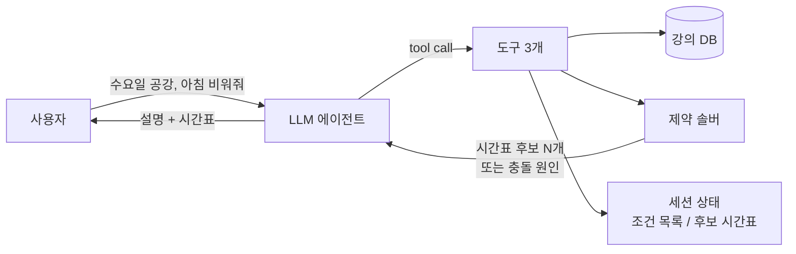

# 원광대학교 인강 스케줄러 에이전트 설계 문서 (MVP)

## 1. 개요

원광대학교 인강 데이터를 바탕으로 한 학기 시간표를 짜주는 대화형 에이전트다.
사용자는 "수요일 공강", "아침 비워줘", "점심 비워줘" 같은 요청을 자연어로 하고, 에이전트는 이를 반영한 시간표 후보를 제시한다.

### 핵심 원칙

**LLM은 대화를 조건으로 바꾸는 일만 하고, 시간표 조합은 제약 솔버가 맡는다.**

LLM이 시간표를 직접 만들면 존재하지 않는 과목을 지어내거나 시간이 겹치는 시간표를 내놓을 수 있다. 그래서 역할을 다음과 같이 나눈다.

| 구성 요소 | 역할 |
|---|---|
| LLM 에이전트 | 자연어 요청을 조건(JSON)으로 변환, 도구 호출, 필요할 때만 되묻기, 결과 설명 |
| 제약 솔버 | 조건을 만족하는 시간표 조합 탐색, 지표 계산, 불가능할 때 완화 방법 탐색 |
| 강의 DB | 과목 데이터 저장과 검색 |
| 세션 상태 | 대화 중 누적된 조건 목록과 현재 후보 시간표 보관 |

## 2. 전체 구조



## 3. 데이터

### 3.1 원본 데이터

원본은 `data/데이터베이스.md`의 마크다운 표다. 2026학년도 교육과정에 학점 기준으로 시간을 배정한 자료이며, 실제 개설 정보가 아니다. `scripts/md_to_csv.py`가 섹션마다 다른 열을 맞춰 `data/courses.csv`로 만든다.

| 섹션 | 열 |
|---|---|
| 전공 | 학기, 구분, 학수번호, 교과목명, 학점, 이론, 실습, 강의시간. 학년은 절 제목에서 가져온다 |
| 교양필수 | 위 열에 영역, 주관학과가 있다 |
| 교양기초·교양선택 | 학기, 구분, 학수번호, 교과목명, 학점, 이론, 실습, 주관학과, 강의시간. 영역은 절 제목에서 가져온다 |

원본은 359행이다. `1, 2`로 적힌 과목은 학기별 두 행으로 나누고, 전공 표와 교양필수 표에 같이 있는 학수번호는 한 행으로 합친다. 분리 결과는 385행(1학기 335, 2학기 50)이다. 카탈로그와 솔버는 1학기 335행만 사용한다. `1, 2` 과목은 1학기 행을 남기고, 2학기 전용 과목은 넣지 않는다.

| 항목 | 규칙 |
|---|---|
| 학기 | 원본은 `1`, `2`, `1, 2`. 카탈로그에 들어가는 값은 `1`이다 |
| 중복 키 | `course_code + semester`. 시간·학점·구분·과목명이 같으면 보조 정보만 합치고, 다르면 변환이 실패한다 |
| 구분 | 원본 코드는 `교필`, `교기`, `교선`, `기전`, `선전`. 조건의 "전공"은 `기전`+`선전`, "교양"은 `교필`+`교기`+`교선` |
| 과목명 | `국문 / 영문`이면 국문을 `name`, 영문을 `name_en`에 둔다 |
| 학점 | 원본은 `3.0` 형식이지만 정수로 저장한다. 정수가 아니면 오류다 |
| 강의시간 | `-`는 슬롯이 없는 성공이다. 현재 그런 과목은 2학기 `L00005` 졸업논문뿐이라 1학기 카탈로그에는 없다. 후보 조합에서는 제외하고, 필요하면 `course` 조건으로만 다룬다 |
| 파싱 | 현재 원본은 규칙 밖의 표기 없이 모두 파싱된다. 실패 행이 있으면 변환은 CSV를 쓰지 않고 목록을 출력한다 |

### 3.2 시간 표기 규칙

요일 필드는 요일 글자 뒤에 교시 숫자가 붙는 형식이다.

- `목3금12` → 목 3교시, 금 1·2교시
- `화910` → 화 9·10교시
- `월10` → 월 10교시

**파싱 규칙**

1. 요일 글자(`월화수목금토일`)를 만나면 새 요일을 시작한다.
2. 이어지는 숫자는 한 자리씩 교시로 읽되, `1` 바로 뒤에 `0`이 오면 `10`(10교시)으로 읽는다.
   교시는 오름차순으로 적히므로 1교시 다음에 0교시가 올 수 없어, 이 경우는 항상 10교시다.
3. 파싱한 교시가 요일 안에서 오름차순이 아니면 오류로 표시하고 원본 데이터를 확인한다.
4. 예비 교시가 `0`으로 표기되면 0교시로 처리한다.

### 3.3 교시와 시각

원광대학교 수업시간표 기준이다. 학과 사정으로 바뀔 수 있으므로 코드에 고정하지 않고 설정 파일(`config/periods.json`)로 관리한다.

| 교시 | 시간 |
|---|---|
| 예비(0) | 08:50 ~ |
| 1 | 09:00 ~ 09:50 |
| 2 | 10:00 ~ 10:50 |
| 3 | 11:00 ~ 11:50 |
| 4 | 12:00 ~ 12:50 |
| 5 | 13:00 ~ 13:50 |
| 6 | 14:00 ~ 14:50 |
| 7 | 15:00 ~ 15:50 |
| 8 | 16:00 ~ 16:50 |
| 9 | 17:00 ~ 17:50 |
| 10 | 18:00 ~ 18:50 |

```json
{
  "period_minutes": 50,
  "periods": {
    "0": "08:50", "1": "09:00", "2": "10:00", "3": "11:00", "4": "12:00", "5": "13:00",
    "6": "14:00", "7": "15:00", "8": "16:00", "9": "17:00", "10": "18:00"
  }
}
```

### 3.4 DB 스키마 (SQLite)

**`courses`**

| 컬럼 | 타입 | 설명 |
|---|---|---|
| `id` | INTEGER PK | 내부 키 |
| `semester` | INTEGER | 카탈로그에서는 `1`. 스키마는 `2`도 허용한다 |
| `course_code` | TEXT | 학수번호. `(course_code, semester)`가 유일하다 |
| `category` | TEXT | 원본 구분 코드 (`교필`, `교기`, `교선`, `기전`, `선전`) |
| `category_group` | TEXT | `전공` 또는 `교양` |
| `name` | TEXT | 국문 과목명 |
| `name_en` | TEXT | 영문 과목명. 없으면 NULL |
| `credits` | INTEGER | 학점 |
| `theory` | INTEGER | 이론 시간. 없으면 NULL |
| `practice` | INTEGER | 실습 시간. 없으면 NULL |
| `raw_time` | TEXT | 원본 시간 문자열 (예: `목3금12`) |
| `schedulable` | INTEGER | 슬롯이 있으면 1, 시간이 `-`이면 0 |
| `year` | INTEGER | 전공 학년. 교양은 NULL |
| `area` | TEXT | 교양 영역. 없으면 NULL |
| `department` | TEXT | 주관학과. 없으면 NULL |

**`course_slots`** (과목 하나가 여러 행을 가짐)

| 컬럼 | 타입 | 설명 |
|---|---|---|
| `course_id` | INTEGER FK | `courses.id` |
| `day` | TEXT | `MON` `TUE` `WED` `THU` `FRI` `SAT` `SUN` |
| `period` | INTEGER | 0 ~ 10 |

예: `목3금12` → `(THU, 3)`, `(FRI, 1)`, `(FRI, 2)`

## 4. 조건(Constraint)

대화로 들어온 요청은 모두 아래 형식으로 변환해 세션에 쌓는다.

```json
{
  "id": "c3",
  "type": "free_slots",
  "params": { "days": ["WED"] },
  "source_text": "수요일 공강으로 해줘"
}
```

- 모든 조건은 **hard**다. 솔버의 제약식으로 들어가며 반드시 지켜진다.
  "가능하면 ~했으면 좋겠어" 같은 표현도 hard로 넣고, 해가 없으면 5.2의 `relaxations`로 완화 방법을 제안한다.
- `source_text`: 사용자의 원래 문장. 나중에 "아까 그 조건 취소해줘" 같은 요청을 처리할 때 쓴다.

### 4.1 조건 종류 (4개)

비슷한 연산은 하나의 타입으로 합치고, 차이는 파라미터로 표현한다.

| type | params | 설명 |
|---|---|---|
| `free_slots` | `days?: string[]`, `periods?: number[]` | 해당 요일·교시에 수업을 두지 않는다. `days`를 생략하면 모든 요일, `periods`를 생략하면 하루 전체 |
| `course` | `course_id: number`, `mode: "require" \| "exclude"` | 과목을 반드시 넣거나 뺀다. 후보의 과목 고정도 `require`로 처리한다 |
| `credits` | `category?: string`, `min?: number`, `max?: number` | `category`가 없으면 총 학점, 있으면 해당 구분의 학점 |
| `limit` | `kind: "days" \| "per_day" \| "consecutive"`, `count: number` | `days`: 등교 요일 수 상한, `per_day`: 하루 과목 수 상한, `consecutive`: 최대 연속 교시 수 |

**요청 → 조건 변환 예시**

| 요청 예시 | type | params |
|---|---|---|
| 수요일 공강 | `free_slots` | `days: ["WED"]` |
| 아침 비워줘 | `free_slots` | `periods: [0, 1]` |
| 점심 비워줘 | `free_slots` | `periods: [4]` |
| 저녁 수업 싫어 | `free_slots` | `periods: [9, 10]` |
| 월요일 오전 비워줘 | `free_slots` | `days: ["MON"], periods: [0, 1, 2, 3]` |
| 18학점 맞춰줘 | `credits` | `min: 18, max: 18` |
| 전공 12학점 이상 | `credits` | `category: "전공", min: 12` |
| 주 3일만 | `limit` | `kind: "days", count: 3` |
| 하루에 2과목까지만 | `limit` | `kind: "per_day", count: 2` |
| 연강 3개 이상은 싫어 | `limit` | `kind: "consecutive", count: 2` |
| 자료구조는 꼭 넣어줘 / 이건 유지해줘 | `course` | `course_id, mode: "require"` |
| 영어회화는 빼줘 | `course` | `course_id, mode: "exclude"` |

### 4.2 모호한 표현의 기본 해석

"아침", "점심" 같은 표현을 몇 교시로 볼지는 **LLM이 `periods`로 펼쳐서 넘긴다.** 솔버는 이 해석 규칙을 알 필요가 없다.

| 표현 | 기본 해석 |
|---|---|
| 아침 | 예비·1교시 (09:50 이전) |
| 점심 | 4교시 (12:00 ~ 12:50) |
| 저녁 | 9·10교시 (17:00 이후) |

에이전트는 기본값으로 처리한 뒤 해석한 내용을 사용자에게 알린다.
예: "1교시를 비웠어요. 2교시까지 비울까요?"

## 5. 도구 (MVP: 3개)

### 5.1 `search_courses`

과목을 검색한다. 결과에 시간 정보까지 포함하므로 별도 상세 조회 도구는 두지 않는다.

```
입력: { query?: string, category?: string, day?: string }
출력: [{ id, category, name, credits, raw_time, slots: [{ day, period }] }]
```

> 과목 수가 100개 수준이면 카탈로그 전체를 시스템 프롬프트에 넣고 이 도구를 없앨 수 있다. 베이스라인 결과(`M1_RESULTS.md`)의 E1·E2를 보고 결정한다. 결정 전까지는 도구로 둔다.

### 5.2 `schedule`

조건을 수정하고 곧바로 솔버를 실행한다. 조건 변경과 재계산을 한 번의 호출로 처리해 상태가 어긋나지 않게 한다.

```
입력: {
  add?: [{ type, params, source_text }],
  remove?: string[],      // 삭제할 조건 id
  n?: number              // 후보 개수, 기본 3
}
출력 (성공): {
  status: "ok",
  constraints: [{ id, type, params, source_text }],   // 적용 후 현재 조건 목록
  candidates: [{
    courses: [{ id, name, credits, raw_time }],
    total_credits,
    days_used: ["MON", ...],
    metrics: { free_periods_by_day, max_consecutive, early_class_count, late_class_count },
    score
  }]
}
출력 (실패): {
  status: "infeasible",
  constraints: [...],
  relaxations: [{ drop: ["c2"] }, ...]   // 이 조건을 빼면 해가 생기는 경우
}
```

- 호출 순서는 `remove` → `add` → 솔버 실행이다.
- 해가 없어도 `add`한 조건은 그대로 저장한다. 사용자가 이어서 어떤 조건을 뺄지 정할 수 있어야 하기 때문이다.
- `relaxations`는 솔버가 계산한다. 조건을 하나씩 빼보며 해가 생기는 경우를 모으고, 하나로는 안 되면 두 개씩 뺀다. 그래도 없으면 빈 배열이다. LLM은 이를 보고 "수요일 공강을 풀면 가능해요"처럼 선택지를 제시할 뿐, 사용자가 요청하기 전에는 조건을 바꾸지 않는다.
- 존재하지 않는 조건 id, 잘못된 `type`이나 `params`는 오류로 반환한다. 이 경우 조건 목록은 바뀌지 않는다.
- `add`와 `remove`가 모두 비어 있으면 현재 조건으로 다시 계산만 한다.

### 5.3 `ask_user`

사용자에게 되묻는다. 되묻기를 에이전트의 명시적인 행동으로 두면 "언제 묻고 언제 알아서 하는가"가 트레이스에 남고 측정할 수 있다.

```
입력: { question: string, options?: string[], reason: string }
출력: 없음. 호출하면 그 턴이 끝난다.
```

도구가 호출되면 에이전트 루프는 즉시 끝나고, UI가 질문을 보여준다. 사용자의 답은 **다음 턴의 일반 메시지**로 들어온다. 루프를 멈추고 기다리는 구조가 아니므로 Streamlit에서도 구현이 단순하다.

**물어보는 경우**

| 상황 | 예 |
|---|---|
| 과목명이 둘 이상과 일치하고 결과에 영향을 줌 | "영어회화"가 2개일 때 |
| 새 조건이 이미 고정한 과목과 충돌함 | 자료구조를 고정했는데 그 시간대를 비워달라고 할 때 |
| 해석에 따라 결과가 크게 달라지고 4.2의 기본 해석으로 정할 수 없음 | "적당히 쉬는 날 하나" |

**알아서 처리하는 경우**

- 4.2에 기본 해석이 있는 표현("아침", "점심", "저녁")은 기본값으로 처리한 뒤 해석한 내용을 알린다.
- 어느 쪽으로 정해도 사용자가 이어서 바로잡을 수 있는 가벼운 선택.

**코드가 보장하는 규칙**

| 규칙 | 구현 |
|---|---|
| 한 턴에 질문은 1개 | `ask_user`가 턴을 끝내므로 구조적으로 보장된다 |
| 연속으로 되묻는 횟수 상한 | 연속 2턴까지. 초과하면 도구가 오류를 반환하고 에이전트는 기본값으로 진행한다 |
| 선택지는 짧게 | `options`는 최대 4개. 초과하면 오류 |
| 답을 받기 전에는 조건이 바뀌지 않는다 | 질문한 턴에는 `ask_user` 이후 도구를 호출할 수 없다. 조건 변경은 답을 받은 다음 턴의 `schedule`에서만 일어난다 |

UI에서는 `options`가 있으면 버튼으로, 없으면 일반 입력으로 보여준다. 버튼을 누르면 해당 문구가 사용자 메시지로 전송된다.

### 5.4 도구로 두지 않은 기능

| 기능 | 처리 방법 |
|---|---|
| 과목 상세 조회 | `search_courses` 결과에 포함 |
| 조건 추가·삭제 | `schedule`의 `add` / `remove` |
| 과목 고정·제외 | `course` 조건 |
| 충돌 원인 설명, 완화 방법 탐색 | `schedule`의 실패 결과(`relaxations`)에 포함 |
| 후보 비교 | 후보 데이터가 대화에 있으므로 LLM이 직접 비교 |
| 조건 목록 조회 | `schedule` 결과의 `constraints`와, 매 턴 시스템 프롬프트에 넣는 현재 조건 목록 |
| 후보별 지표 계산 (공강 시간, 연강, 아침 수업 수 등) | 솔버가 `schedule` 출력의 `metrics`에 넣음. LLM이 직접 세지 않는다 |

## 6. 제약 솔버

- 도구: OR-Tools CP-SAT
  - 100개 규모는 단순 탐색으로도 가능하지만, 조건 종류가 늘어나는 것을 고려해 처음부터 CP-SAT을 쓴다.
- 결정 변수: 과목마다 선택 여부 `x[course] ∈ {0, 1}`
- 기본 조건
  - 같은 요일, 같은 교시를 공유하는 과목은 함께 고를 수 없다.
- 사용자 조건 → 제약식

| type | 제약식 |
|---|---|
| `free_slots` | 금지 슬롯 집합(요일×교시)과 겹치는 슬롯이 하나라도 있는 과목은 `x = 0` |
| `course` | `require`면 `x = 1`, `exclude`면 `x = 0` |
| `credits` | 선택된 과목(해당 `category`만)의 학점 합이 `[min, max]` 범위 |
| `limit` | `days`: 요일별 사용 여부 변수의 합 ≤ count, `per_day`: 요일별 선택 과목 수 ≤ count, `consecutive`: 어느 연속 구간에도 count+1개 교시가 모두 차지 않음 |

- 목적함수
  - 사용자 선호가 없는 부분의 순위를 정하는 기본값이다. 등교 요일 수를 최소화하고, 같으면 이른 교시와 늦은 교시 수업이 적은 쪽을 앞에 둔다.
- 출력
  - 점수 순 상위 n개. 후보끼리 너무 비슷하지 않도록 이전 해를 배제하는 제약을 추가하며 반복 탐색한다.
- 해가 없을 때
  - 조건을 하나씩 빼고 다시 풀어, 해가 생기는 조건을 `relaxations`로 반환한다. 하나로 안 되면 두 개씩 뺀다.

## 7. 대화 흐름 예시

```
사용자: 18학점으로 짜줘. 수요일은 공강이었으면 좋겠어.
에이전트: schedule(add: [credits 18~18, free_slots days=[WED]], n: 3)
          → 후보 3개 제시 (등교 요일, 1교시 수업 수, 공강 시간 요약)

사용자: 2번 좋은데 아침 수업 너무 많다.
에이전트: schedule(add: [course(2번의 전공과목, require), free_slots periods=[0,1]], n: 3)
          → "2번의 전공과목은 유지하고, 1교시 교양을 다른 과목으로 바꿨어요.
             2교시까지 비울까요?"

사용자: 아까 수요일 공강은 취소해줘.
에이전트: schedule(remove: ["c2"], n: 3)

사용자: 영어회화는 빼줘.
에이전트: search_courses("영어회화") → 2개 (월 3·4교시, 목 5·6교시)
          ask_user("영어회화가 두 개 있어요. 둘 다 뺄까요?",
                   options: ["둘 다 제외", "월요일 것만", "목요일 것만"],
                   reason: "과목명이 둘과 일치함")
          ← 이 턴은 여기서 끝난다

사용자: 둘 다.   (버튼 클릭)
에이전트: schedule(add: [course(영어회화 월, exclude), course(영어회화 목, exclude)], n: 3)

사용자: 주 3일만 다니고 싶어.
에이전트: schedule(add: [limit days=3])
          → status: infeasible, relaxations: [{drop: ["c1"]}]
          → "18학점을 유지하면 주 3일은 어려워요. 학점을 줄이면 가능해요.
             학점 조건을 풀까요?"
```

## 8. 기술 스택

| 영역 | 선택 |
|---|---|
| 언어 | Python |
| DB | SQLite |
| 솔버 | OR-Tools CP-SAT |
| LLM | OpenAI 또는 Claude의 function calling |
| UI | Streamlit (왼쪽 채팅, 오른쪽 주간 시간표 그리드) |

## 9. 폴더 구조 (예정)

```
scheduler/
├── config/
│   └── periods.json     # 교시-시각 매핑
├── data/                # 원본 강의 데이터
├── db/                  # 스키마, 로더, 시간 문자열 파서
├── solver/              # CP-SAT 모델, 조건 → 제약식 변환
├── agent/               # 시스템 프롬프트, 도구 정의, 대화 루프
├── app/                 # Streamlit UI
├── tests/               # 파서·솔버 테스트
└── docs/
    └── DESIGN.md
```

## 10. 개발 순서

0. 베이스라인 실험: 에이전트 구조 없이 기본 모델만으로 할루시네이션 없이 시간표를 짤 수 있는지 확인한다. 결과에 따라 아래 설계를 조정한다. (`BASELINE_EXPERIMENT.md`)
1. 데이터 로딩: 시간 문자열 파서 작성, 100개 과목 전부 파싱되는지 확인
2. 솔버 단독 개발: 조건 JSON을 넣으면 시간표가 나오는지 테스트
3. 에이전트 연결: 자연어가 올바른 조건 JSON으로 바뀌는지, 되묻기(`ask_user`)가 필요한 때에만 일어나는지 확인
4. UI 연결

졸업요건 반영은 보류한다.

## 11. 남은 확인 사항

- 데이터 파일 형식, 파싱 예외, 구분 값은 3.1에서 확인했다. 원본은 마크다운 표이고, 현재 파일은 모두 파싱된다.
- `search_courses`를 유지할지, 카탈로그를 프롬프트에 넣고 제거할지 (베이스라인 실험 결과로 결정). 카탈로그는 1학기 335과목이다.
