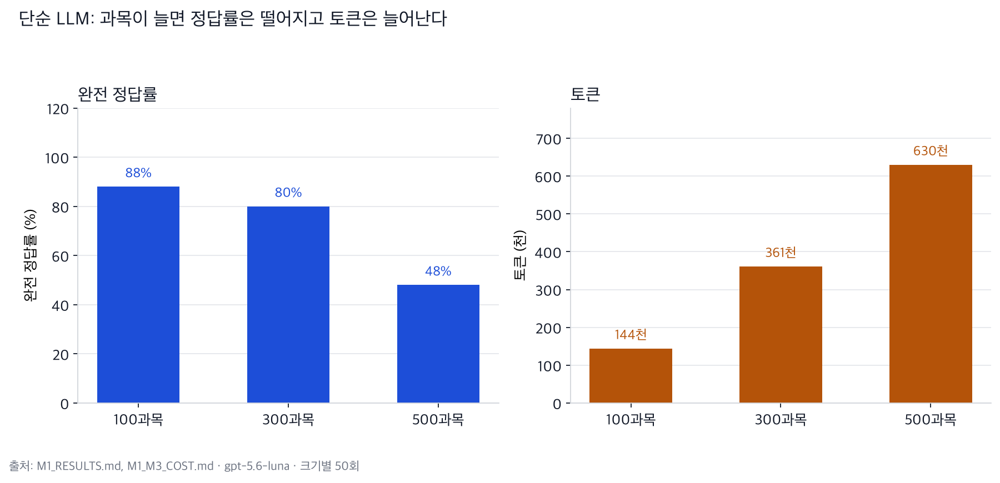
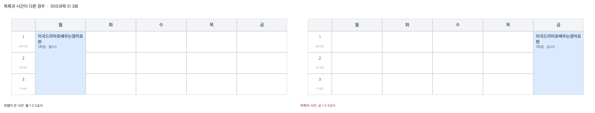

# 발표 구성 (10분)

강의 데이터를 LLM에 직접 넣는 방식의 한계를 실험으로 확인하고, 솔버 기반 에이전트로 해결한 과정을 발표한다.
수치의 출처는 `M1_RESULTS.md`, `M1_M3_COST.md`, `MILESTONES.md`다.

## 흐름 요약

| # | 슬라이드 | 시간 | 핵심 메시지 |
|---|---|---|---|
| 1 | 시작 이유 | 1:00 | 강의 데이터를 LLM에 넣었더니 금방 사용량이 소진되고 결과도 틀렸다 |
| 2 | 문제 정의와 실험 설계 | 1:00 | 감이 아니라 결정적 채점기로 측정했다 |
| 3 | 단순 LLM 결과 | 1:30 | 과목이 늘수록 정확도는 떨어지고 비용은 늘어난다 |
| 4 | 실패 사례 | 1:00 | 틀렸는데 맞다고 하거나, 목록과 다른 시간을 적는다 |
| 5 | 해결 방향과 설계 근거 | 1:00 | 자율성은 판단에만, 정확성은 코드가 맡긴다 |
| 6 | 에이전트 구조 | 1:00 | LLM, 솔버, 검증기의 역할 분담 |
| 7 | 개선 결과 | 1:30 | 정확도, 토큰, 시간이 모두 개선됐다 |
| 8 | 실사용 데모 | 2:00 | 되묻기, 멀티턴 수정, 불가능 조건 대응 |
| 9 | 개발 과정과 한계 | 0:30 | 마일스톤 순서대로 개발했고, 한계는 먼저 밝힌다 |
| 10 | 앞으로 개선 사항 | 0:30 | 학기별 계산, 졸업요건 등 |

합계 11분이다. 시간이 모자라면 4번을 3번에 합치거나 9번을 줄인다.

## 1. 프로젝트 시작 이유 (1분)

- 학기 중 강의 목록을 LLM에 넣고 시간표를 짜려 했다.
- 사용량이 금방 소진됐고, 결과는 시간 충돌이 나거나 조건이 틀렸다.
- 질문을 던진다: "강의 데이터를 통째로 LLM에 넣는 방식이 정말 맞을까?"
- 이 질문이 이후 실험의 출발점이다.

## 2. 문제 정의와 실험 설계 (1분)

**평가 방법**

- 모델: `gpt-5.6-luna`
- 데이터 크기: 100·300·500과목
- 시나리오: S1–S10 (아래 표)
- 반복: 5회, 총 150회 실행

**시나리오 (쉬운 요청에서 어려운 요청 순)**

| ID | 유형 | 요청 |
|---|---|---|
| S1 | 단일 조건 | 18학점으로 짜줘 |
| S2 | 요일 | 18학점, 수요일 공강 |
| S3 | 교시 | 18학점, 아침 1교시 비워줘 |
| S4 | 교시 | 18학점, 점심(4교시) 비워줘 |
| S5 | 복합 | 18학점, 수요일 공강, 점심 비우기, 주 3일 |
| S6 | 과목 지정 | 데이터구조는 꼭 넣고 영어회화는 빼줘 |
| S7 | 구분별 학점 | 전공 12학점 이상, 총 18학점 |
| S8 | 불가능한 요청 | 월~금 0~10교시를 전부 비워줘 (해가 없다. 불가능하다고 답해야 정답) |
| S9 | 멀티턴 | S2 결과에 "아침도 비워줘" |
| S10 | 멀티턴 | S9 결과에 "아까 수요일 공강은 취소해줘" |

- 발표에서는 표를 전부 읽지 않는다. 유형(단일, 요일, 교시, 복합, 과목 지정, 학점, 불가능, 멀티턴)만 짚고, S8과 S9·S10만 따로 설명한다.
- S8은 모델이 불가능을 인정하는지, 조건을 몰래 어기고 시간표를 내놓는지 보는 시나리오다. 단순 LLM은 15회 모두 불가능이라고 맞혔다.
- S9·S10은 이전 발화를 이어 받는 멀티턴이다. 단순 LLM은 500과목에서만 실패했다.

**채점**

- LLM이 아니라 코드로 하는 결정적 채점기를 쓴다.
- 오류는 E1~E8로 분류한다.
  - 환각: E1 존재하지 않는 과목, E2 속성 오기재
  - 추론 오류: E3 시간 충돌, E5 조건 위반 등

**비교 방식**

- 같은 시나리오, 같은 모델, 같은 채점기로 두 방식을 비교했다.

## 3. 단순 LLM 결과 (1분 30초)

| 데이터 | 완전 정답 | 토큰 | 시간 |
|---|---|---|---|
| 100과목 | 88% (44/50) | 143,970 | 9분 14초 |
| 300과목 | 80% (40/50) | 360,826 | 9분 14초 |
| 500과목 | 48% (24/50) | 630,484 | 11분 10초 |

- 시스템 프롬프트가 100과목 1,794토큰에서 500과목 9,299토큰으로 늘어난다.  


## 4. 실패 사례 (1분)

다섯 건 표 대신 대표 두 장만 보여준다. 시간표는 `app/image.py`로 그렸다. 나머지 유형은 `M1_RESULTS.md`에 있고, 질문받으면 말한다.

겹침사례, 시간 오기재 사례

**1. 틀렸는데 맞았다고 함** (겹침사례)


- 요청: 18학점, 수요일 공강.
- 모델 설명: "과목 간 시간 중복도 없습니다."
- 실제: 금요일 3교시에 창업실무(금123)와 프리젠테이션스킬업(금34)이 겹친다.
- 과목 시간은 목록과 같다. 조합을 잘못 계산하고도 맞다고 한 경우다.

**2. 목록에서 가져왔는데 시간이 다름** (시간오기재사례)



- 과목: 미국드라마로배우는영어표현.
- 모델이 쓴 시간: 월123. 목록의 시간: 금123.
- 과목 이름은 목록에 있지만 시간을 잘못 베꼈다. 목록 시간으로 다시 세면 다른 과목과 겹친다.
- 500과목에서만 이런 속성 오기재(E2)가 15회 나왔다. 100·300과목은 0회다.

**핵심: 하나는 계산을 틀리고, 하나는 목록의 정보를 틀리게 옮긴다.**

## 5. 해결 방향과 설계 근거 (1분)

**실험 결과가 가리킨 방향**

겹침 사례는 과목 시간은 맞는데 "중복 없다"고 한 것으로, LLM이 자기 계산을 검증하지 못하는 할루시네이션으로 봤다. 시간 오기재는 100·300과목에서는 없고 500과목에서만 나와, 수백 개 강의를 한꺼번에 넣으면서 생긴 문제로 봤다. 그래서 조합은 솔버가 계산하게 하고, 강의 목록은 통째로 넣지 않고 필요한 과목만 조회하게 했다.

**솔버란? 계산기와 통역사로 설명**

- 솔버는 "조건을 주면 조건을 지키는 답을 계산해 주는 계산기"다. 계산이라 틀리지 않고, 답이 없으면 없다고 말한다.
- 사용한 솔버는 Google OR-Tools의 CP-SAT이다.

학생은 "수요일은 공강, 아침은 비워줘"처럼 말로 요청한다. 솔버는 단순 계산기라 이 말을 그대로 알아듣지 못하고, LLM만 쓰면 말은 알아듣지만 앞에서 본 것처럼 겹침 계산을 틀린다. 그래서 LLM이 요청사항을 조건으로 변환하고, 그 조건을 솔버에 주입하여 결과를 얻는 방식이다.

**핵심 문장: "자율성은 판단에만, 정확성은 코드가"**

## 6. 에이전트 구조 (1분)

**도구를 준다는 것**

LLM은 문장만 만든다. 강의 검색, 시간표 계산, 되묻기는 미리 만들어 둔 함수이고, LLM에게는 이 함수들의 이름과 쓰는 법만 알려 준다. LLM은 사용자 말을 보고 어떤 함수를 부를지 고르고, 실제 실행은 그 함수가 한다.

다이어그램 한 장으로 보여준다.

```
사용자 ↔ LLM(에이전트)
          ├─ search_courses → 강의 DB
          ├─ schedule(add/remove/n) → 세션 조건 → CP-SAT 솔버 → 시간표
          └─ ask_user → 사용자에게 되묻기
```

- `search_courses`는 시간 오기재를 막기 위한 도구다. 수백 개 강의를 넣지 않고, "영어회화 빼줘"처럼 필요한 과목만 DB에서 가져온다.
- `schedule`은 겹침 사례를 막기 위한 도구다. LLM이 조건을 넘기면 솔버가 시간표를 계산하므로, 겹치는데 "중복 없다"고 답하지 못한다.
- `ask_user`는 요청이 모호할 때 사용자에게 되묻기 위한 도구다. 같은 이름 과목이 둘이면 어느 쪽인지 확인한다.
- 조건은 서버 세션에 쌓이고, 사용자가 요청할 때만 바뀐다. 탐색 단계, 비용, 되묻기 횟수에는 상한을 둔다.

## 7. 개선 결과 (1분 30초)

| 지표 | 단순 LLM (M1) | 에이전트+솔버 (M3) | 개선 |
|---|---|---|---|
| 완전 정답 (100과목) | 88% | 100% (50/50) | +12%p |
| 완전 정답 (300과목) | 80% | 100% (50/50) | +20%p |
| 완전 정답 (500과목) | 48% | 100% (50/50) | +52%p |
| 총 토큰 | 1,135,280 | 115,317 | 9.8배 감소 |
| 500과목 토큰 | 630,484 | 38,461 | 16.4배 감소 |
| 총 소요 시간 | 29분 38초 | 8분 3초 | 3.7배 단축 |
| 시나리오 1회 평균 | 11.9초 | 3.2초 | 3.7배 단축 |

- search_courses로 인해 필요한 과목만 찾아 넣기때문에 수백개의 강의가 LLM에 주입되지 않아 토큰이 감소하게된다. 
- 또한 솔버를 통해 계산하기때문에 LLM보다 빠르게 계산이 진행된다.  


## 8. 실사용 영상과 이미지 (2분)

영상은 1분 이내로 압축한다. 라이브보다 녹화가 안전하다.

**보여줄 장면**

1. 자연어로 요청해서 시간표가 나오는 장면
2. 같은 이름의 과목이 둘일 때 되묻는 장면 (`ask_user`)
3. "아침 비워줘"처럼 모호하지만 되묻지 않고 기본 해석으로 처리하는 장면 (`free_slots [0,1]`)
4. "아까 수요일 공강 취소해줘" 같은 멀티턴 수정
5. 불가능한 조건에서 완화 방안을 제시하는 장면

**이미지**

- Streamlit 채팅 화면
- 주간 그리드 시간표

## 9. 개발 과정과 한계 (30초)

**개발 과정**

- 마일스톤 순서대로 개발했다: M0 데이터 → M1 베이스라인 → M2 솔버 → M3 솔버 비교 → M4 에이전트 → M5 UI

**한계**

- 500과목 데이터는 실제 데이터를 변형해 만든 합성 데이터다. 실제 데이터는 335과목이다.
- 모델은 `gpt-5.6-luna` 하나만 썼다.
- 졸업요건 반영은 아직 하지 않았다.

## 10. 앞으로 개선 사항 (30초)

- 학기별 계산: 여러 학기에 걸친 과목 배치
- 졸업요건 계산: 이수 구분별 부족 학점 확인
- 실제 학교 데이터 확대와 자동 갱신
- 여러 후보 시간표 비교 (`n` 옵션)
- 교수, 평점 같은 선호 조건
- 다른 학교로 확장

## 발표 팁

- 3번과 7번 그래프는 `image/chart_m1.png`, `image/chart_m1_m3.png`다. 가로축은 둘 다 데이터 크기다.
- 1번(시작 이유)과 4번(실패 사례)이 이어지도록 말한다. 처음 겪은 문제를 실험으로 재현했다는 흐름이 된다.
- 예상 질문에 답을 준비한다.
  - 왜 이 모델을 썼는가
  - 더 큰 모델이면 해결되는가
  - 솔버가 못 푸는 경우는 없는가
